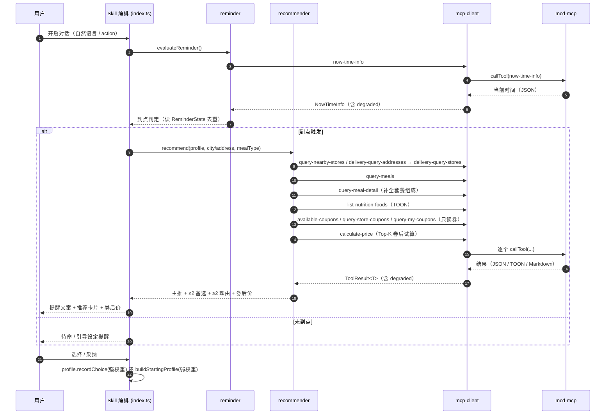
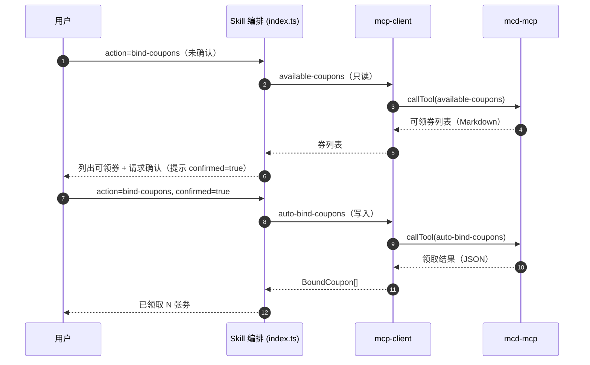

# MCP 集成说明（MCP_INTEGRATION）

> 本文档如实描述「套餐推荐助手（mcd-meal-recommender）」对麦当劳 MCP 的实际集成方式，包括使用的 MCP Server、调用的 Tool、鉴权方式、调用流程、错误与降级策略及业务价值。
> 本文档与设计文档 [`docs/01_DESIGN/00_系统架构与详细设计主文档_最新.md`](./docs/01_DESIGN/00_系统架构与详细设计主文档_最新.md) §3.1「MCP 工具契约」保持一致。

---

## 1. 使用的 MCP Server

| 项 | 内容 |
|----|------|
| **Server 名称** | `mcd-mcp`（麦当劳 MCP Server） |
| **工具能力标识** | `mcd-mcp` |
| **传输方式** | **Streamable HTTP** |
| **端点 URL** | `https://mcp.mcd.cn` |
| **客户端 SDK** | `@modelcontextprotocol/sdk`（`StreamableHTTPClientTransport`） |
| **客户端标识** | `mcd-meal-recommender` v1.3.0 |
| **接入层实现** | `src/mcp-client/`（统一鉴权、限流退避、按格式解析、缓存、离线降级） |
| **宿主声明** | `.mcp.json` 声明 `mcpServers["mcd-mcp"]`，`type: streamablehttp`，`Authorization: Bearer ${MCD_MCP_TOKEN}` |

> 接入约束：业务层（`recommender` / `profile` / `reminder` / `index`）**不得越过 `mcp-client` 直连 MCP SDK**，以保证鉴权、限流、解析与降级策略统一。

---

## 2. 鉴权方式

- **方式**：HTTP 请求头 `Authorization: Bearer ${MCD_MCP_TOKEN}`。
- **来源**：Token 仅经环境变量 `MCD_MCP_TOKEN` 注入（`src/mcp-client/config.ts`），**禁止硬编码或入库**；仓库仅保留 `.env.example` 占位。
- **未配置 Token**：抛出 `TOKEN_MISSING`，按降级策略回退离线演示数据（`degraded=true`）。
- **鉴权失败（401/403）**：映射为 `AUTH_FAILED`，提示更新 `MCD_MCP_TOKEN`；本次调用降级离线数据。
- **限流**：Token 上限约 600 次/分钟 → 接入层实施**并发上限 + 指数退避 + 结果缓存**。

---

## 3. 实际调用的 Tool（共 13 个）

> 工具名常量定义于 `src/mcp-client/config.ts`（`TOOL`），封装于 `src/mcp-client/tools.ts`。
> 「链路」列说明该工具在当前版本的使用位置：**主链路**（推荐/提醒流程实际调用）、**写操作**（须用户显式确认）或**已封装·预留**（已实现封装与离线数据，当前不在业务流程调用，列入后续版本候选）。

| # | Tool | 用途 | 关键入参 | 返回格式 | 链路 |
|---|------|------|---------|---------|------|
| 1 | `now-time-info` | 获取当前时间，用于到点判断 | 无 | **JSON** | 主链路（提醒） |
| 2 | `query-nearby-stores` | 附近门店（到店） | `searchType, beType, city / keyword 或经纬度` | **JSON** | 主链路（推荐） |
| 3 | `delivery-query-addresses` | 获取可配送地址列表 | 无 | **JSON** | 主链路（推荐） |
| 4 | `delivery-query-stores` | 可配送门店（麦乐送） | `addressId, beType(2)` | **JSON** | 主链路（推荐） |
| 5 | `query-meals` | 门店可售餐品 | `storeCode, beCode, orderType, beType, reservationDate?` | **JSON**（`meals{}` map） | 主链路（推荐） |
| 6 | `query-meal-detail` | 套餐组成 / 详情 | `code, storeCode, beCode, orderType, beType, reservationDate?` | **JSON** | 主链路（推荐） |
| 7 | `list-nutrition-foods` | 营养信息 | 无 | **TOON 文本** | 主链路（推荐） |
| 8 | `available-coupons` | 可领券列表（只读） | 无 | **Markdown** | 主链路（推荐/领券） |
| 9 | `query-store-coupons` | 门店可用券（只读） | `storeCode, beCode, orderType, beType, reservationDate?` | **JSON** | 主链路（推荐） |
| 10 | `query-my-coupons` | 我的券（只读） | 无 | **Markdown** | 主链路（推荐） |
| 11 | `calculate-price` | 价格试算（券后价） | `storeCode, beCode, orderType, beType, items[]`（含 `productCode, quantity, couponId, couponCode`） | **JSON** | 主链路（推荐） |
| 12 | `campaign-calendar` | 活动日历（活动联动，可选） | `specifiedDate?`（`yyyy-MM-dd`） | **Markdown** | 已封装·预留 |
| 13 | `auto-bind-coupons` ⚠️ | 一键领券（**写操作**） | 无 | **JSON** | 写操作（须用户显式确认） |

### 3.1 按返回格式的解析策略

- **JSON 类**（`now-time-info`、门店 / 菜单 / 详情、`query-store-coupons`、`calculate-price`、`auto-bind-coupons`）→ **zod 校验 + 类型推导**（`src/mcp-client/parsers/json.ts`）。
- **TOON 文本**（`list-nutrition-foods`）→ 专用 TOON 解析器（`parsers/toon.ts`），解析后按 `productName` 与候选项匹配。
- **Markdown 文本**（`available-coupons`、`query-my-coupons`、`campaign-calendar`）→ 结构化抽取（优先表格、回退列表项，`parsers/markdown.ts`）+ 容错。
- **解析失败**：列表类（只读券 / 营养 / 活动）视为空结果并告警、**不中断**推荐；关键类抛 `PARSE_ERROR`。

---

## 4. 调用流程 / 时序

### 4.1 端到端主链路（对话式）

### 4.2 领券（写操作，独立于主链路）

> 写操作 `auto-bind-coupons` **不在**推荐主链路调用，仅在用户**显式确认**（`confirmed=true`）后由编排层单独触发。

---

## 5. 错误与降级策略

接入层对每个工具返回 `ToolResult<T>`（含 `degraded` 标记），任何 MCP 异常都**不导致 Skill 崩溃**。

| 场景 | 错误码 | 处理策略 |
|------|--------|---------|
| 未配置 Token / 401 / 403 | `TOKEN_MISSING` / `AUTH_FAILED` | 提示配置或更新 `MCD_MCP_TOKEN`；回退离线演示数据（`degraded=true`） |
| 429 限流 | `RATE_LIMITED` | **指数退避重试**（`delay = backoffBaseMs · 2^attempt`，默认上限 3 次）+ 并发限流（默认 4）+ 缓存优先；重试耗尽后降级离线 |
| 超时 | `TIMEOUT` | 单次调用默认超时 10s，有限重试；失败降级离线 |
| 解析失败（非 JSON / TOON / Markdown） | `PARSE_ERROR` | 列表类工具视为空结果并告警、不中断；关键类抛出并由编排层转为友好提示 |
| 业务空结果 | `EMPTY_RESULT` | 明确告知（无可用门店 / 餐品），提示换城市 / 关键词或稍后重试 |
| `MCD_OFFLINE=1` | — | **直接使用离线演示数据，零 MCP 调用**（`degraded=true`） |
| 非法输入 | `VALIDATION_ERROR` | zod 校验拒绝并友好提示，用户重新输入 |

**缓存 TTL**：菜单 / 营养 10 分钟、券 5 分钟（`src/mcp-client/config.ts`），以缓解限流并提升响应速度。

**统一错误类型**：跨层统一使用 `AppError`（`src/core/errors.ts`），编排层通过 `friendlyErrorMessage` 映射为中文提示，**绝不暴露内部堆栈**。

---

## 6. 业务价值

| 维度 | 价值说明 | 依赖的 MCP 能力 |
|------|---------|----------------|
| **券后省钱** | 结合只读券与 `calculate-price` 实际试算，给出**券后最低价**套餐，避免"券互斥 / 不可叠加"误判 | `available-coupons` / `query-store-coupons` / `query-my-coupons` + `calculate-price` |
| **营养可解释** | 基于营养数据做约束与展示，热量 / 蛋白质可解释，标注"仅供参考" | `list-nutrition-foods`（TOON） |
| **到点提醒闭环** | 到点提醒 + 顺手推荐，把"提醒"与"决策"合并为一步 | `now-time-info` + 门店 / 菜单数据 |
| **个性化推荐** | 结合门店可售、套餐详情与用户画像，给出"够好"的默认套餐并可解释 | `query-nearby-stores` / `delivery-query-*` / `query-meals` / `query-meal-detail` |
| **便捷领券** | 用户确认后一键领券，减少手动操作 | `auto-bind-coupons`（写操作） |

---

## 7. 不使用的工具 / 交易边界

- **明确不使用 `create-order`（下单）与 `cancel-order`（取消订单）**：本作品交易边界**止于下单引导**，不代用户完成下单 / 支付等交易行为。
- **不使用 `create-order`** 亦符合需求与设计约束（见 `docs/01_DESIGN/.../§3.1`、需求 §6.5）。
- **写操作最小化**：仅 `auto-bind-coupons` 一个写操作，且须用户**显式确认**后调用。

---

## 8. 相关文档

- 设计（MCP 工具契约 §3.1）：[`docs/01_DESIGN/00_系统架构与详细设计主文档_最新.md`](./docs/01_DESIGN/00_系统架构与详细设计主文档_最新.md)
- 增量技术设计（§3 契约 / §4.1 时序）：[`docs/01_DESIGN/01_changes/v1.0.0_套餐推荐助手核心_技术设计.md`](./docs/01_DESIGN/01_changes/v1.0.0_套餐推荐助手核心_技术设计.md)
- Skill 元数据：[`SKILL.md`](./SKILL.md)
- 项目说明：[`README.md`](./README.md)
